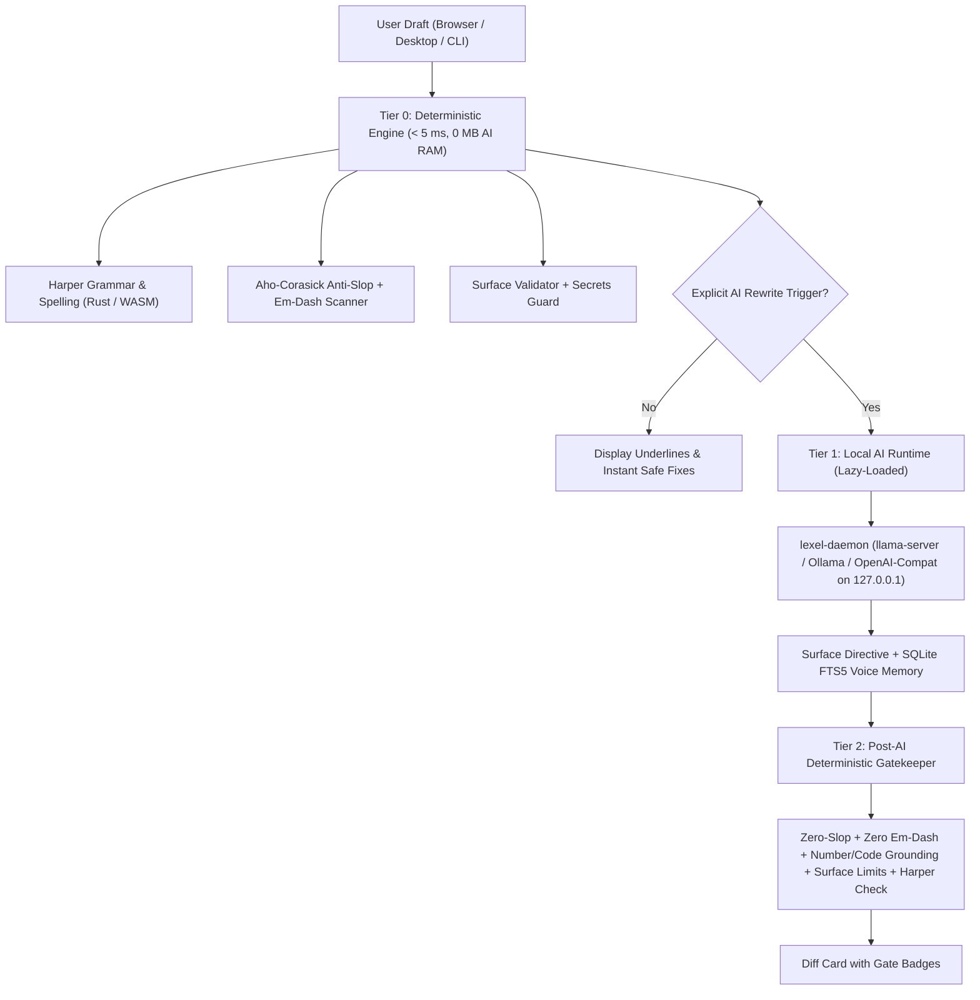
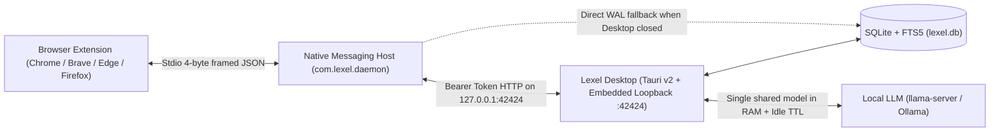

# Lexel Architecture

This document summarizes how Lexel's Rust crates, Tauri Desktop app, browser extension, and shared SQLite database fit together.

## 1. Three-Tier Execution Pipeline

## 2. Live Desktop <-> Browser Extension Sync

Lexel Desktop (`apps/lexel-desktop`) and the Browser Extension (`packages/lexel-browser`) share a single source of truth on disk (`lexel.db`):

### How Sync Flows in Both Directions

1. **Extension -> Desktop:** When you change a dialect, grammar rule, custom dictionary word, surface override, privacy domain, or profile in the extension, `background/index.ts` sends a Native Messaging RPC. `lexel-daemon` forwards mutating RPCs to Lexel Desktop's loopback server (`127.0.0.1:42424`), which updates `lexel.db` and emits `lexel://state-changed` to the Tauri webview immediately. If Desktop is closed, `lexel-daemon` writes directly to `lexel.db` via SQLite WAL mode.
2. **Desktop -> Extension:** When you edit settings in Lexel Desktop, the embedded `DaemonService` updates `lexel.db` and bumps `profile.updatedAt`. When you switch back to your browser window or open the popup/options/sidepanel, the extension compares `activeProfile.id + updatedAt`, writes changes to `chrome.storage.local`, reloads the in-memory Harper WASM linter if grammar/dialect/dictionary changed, and notifies open tabs via `chrome.storage.onChanged`.

## 3. Single Source of Truth Data Files

- `rules/slop_terms.json`: Canonical AI buzzwords, em-dash policy, and deterministic plain-English replacements read by `crates/lexel-core` and `packages/lexel-ui`.
- `rules/lexel-antislop.weirpack`: Compiled, unit-tested Harper Weirpack generated via `lexel-cli weirpack build-antislop`.
- `ml/personas/surfaces.json`: Canonical platform surface profiles (character bounds, host globs, path regexes, forbidden openers, prompt directives, quick actions) read by Rust and TypeScript.
- `models/manifest.json`: Verified GGUF URLs, exact byte sizes, RAM estimates, and SHA-256 digests for `lexel-0.5b` and `lexel-1.5b`.

## 4. Upstream Harper Isolation

`vendor/harper` is mounted as an unmodified Git submodule excluded from Lexel's root Cargo workspace. Lexel crates depend on `harper-core`, `harper-comments`, `harper-git-commit`, `harper-thesaurus`, and language parsers via path dependencies, keeping `make sync-harper` conflict-free.
